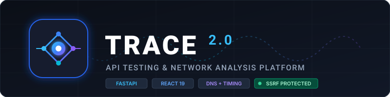
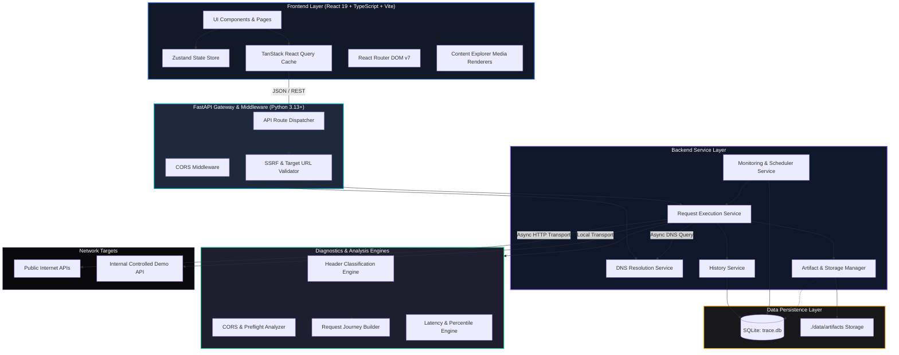
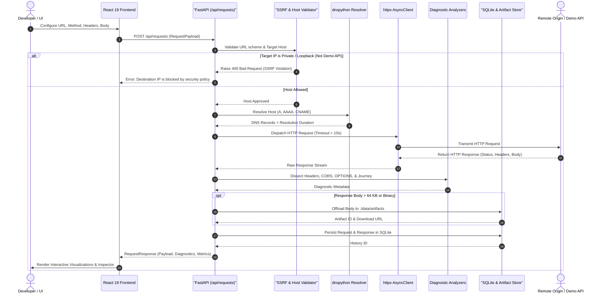
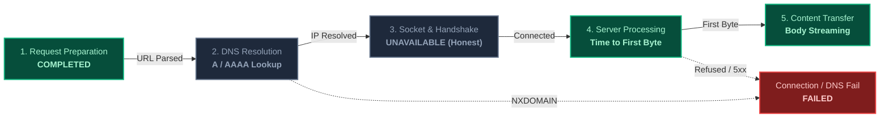
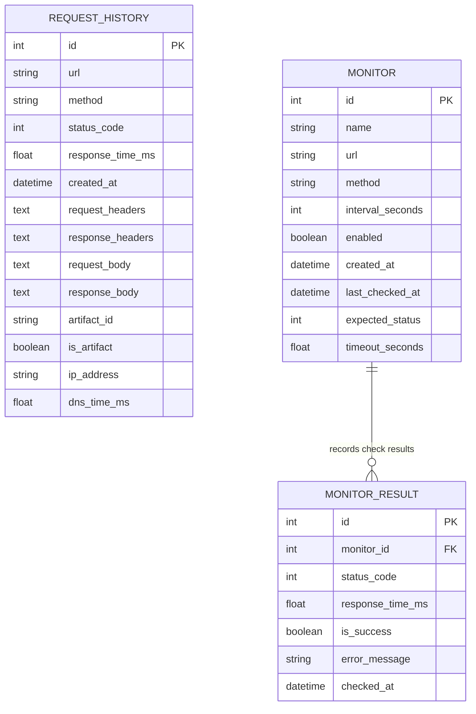

<p align="center">
  
</p>

<p align="center">
  <strong>The modern API testing client and network diagnostics platform designed to demystify HTTP execution, visualize transport lifecycles, and bridge theoretical networking with real-world engineering.</strong>
</p>

<p align="center">
  <a href="https://fastapi.tiangolo.com/"></a>
  <a href="https://react.dev/"></a>
  <a href="https://www.typescriptlang.org/"></a>
  <a href="https://vitejs.dev/"></a>
  <a href="https://tailwindcss.com/"></a>
  <a href="https://www.python.org/"></a>
  <a href="https://sqlite.org/"></a>
  <a href="#"></a>
  <a href="LICENSE"></a>
</p>

---

## 📑 Table of Contents

- [Overview &amp; Philosophy](#-overview--philosophy)
  - [The Problem with Conventional Tools](#the-problem-with-conventional-tools)
  - [The TRACE Solution](#the-trace-solution)
  - [Core Architectural Principles](#core-architectural-principles)
- [Key Features](#-key-features)
- [System Architecture](#-system-architecture)
  - [Component Architecture](#component-architecture)
  - [Complete Request Workflow](#complete-request-workflow)
- [The Request Journey Explained](#-the-request-journey-explained)
- [Feature Deep Dive](#-feature-deep-dive)
  - [1. Interactive API Tester](#1-interactive-api-tester)
  - [2. Multi-Faceted Response Inspector](#2-multi-faceted-response-inspector)
  - [3. Deep DNS Inspector](#3-deep-dns-inspector)
  - [4. Header Analyzer &amp; Security Auditing](#4-header-analyzer--security-auditing)
  - [5. CORS &amp; OPTIONS Preflight Diagnostic](#5-cors--options-preflight-diagnostic)
  - [6. Request Waterfall &amp; Latency Analytics](#6-request-waterfall--latency-analytics)
  - [7. Advanced JSON Explorer](#7-advanced-json-explorer)
  - [8. Universal Content Explorer &amp; Media Engine](#8-universal-content-explorer--media-engine)
  - [9. YouTube Intelligence Analyzer](#9-youtube-intelligence-analyzer)
  - [10. Artifact Storage, Inspection &amp; ZIP Bundling](#10-artifact-storage-inspection--zip-bundling)
  - [11. Persistent Request History &amp; Visual Diff](#11-persistent-request-history--visual-diff)
  - [12. Autonomous Endpoint Monitoring &amp; SLAs](#12-autonomous-endpoint-monitoring--slas)
  - [13. Controlled Demo API Service](#13-controlled-demo-api-service)
  - [14. Theme System &amp; Visual Experience](#14-theme-system--visual-experience)
- [Controlled Demo API Reference](#-controlled-demo-api-reference)
- [Backend REST API Specification](#-backend-rest-api-specification)
- [Security &amp; Boundary Guardrails](#-security--boundary-guardrails)
- [Technology Stack](#-technology-stack)
- [Project Directory Structure](#-project-directory-structure)
- [Installation &amp; Local Setup](#-installation--local-setup)
  - [Prerequisites](#prerequisites)
  - [Option A: One-Command Startup (Recommended)](#option-a-one-command-startup-recommended)
  - [Option B: Manual Service Startup](#option-b-manual-service-startup)
- [Testing &amp; Quality Verification](#-testing--quality-verification)
- [Database Schema &amp; Storage](#-database-schema--storage)
- [Troubleshooting &amp; FAQ](#-troubleshooting--faq)
- [Technical Honesty &amp; Measurement Boundaries](#-technical-honesty--measurement-boundaries)
- [Future Scope &amp; Roadmap](#-future-scope--roadmap)
- [License &amp; Acknowledgments](#-license--acknowledgments)

---

## 💡 Overview & Philosophy

### The Problem with Conventional Tools

Traditional API clients (such as Postman, Insomnia, or Thunder Client) encourage a simplified mental model of network communication:

$$\text{Request Payload} \xrightarrow{\quad\text{Instantaneous Black Box}\quad} \text{Response Body}$$

When an API call functions properly, this abstraction is convenient. However, when an API call fails, changes behavior across environments, suffers from unpredictable latency, or violates security policies, this abstraction collapses:

- **Opaque CORS Errors**: The browser displays `Network Error` or generic CORS rejection without detailing whether the issue stems from missing HTTP methods, disallowed headers, credential constraints, or preflight failure.
- **Invisible DNS Delays**: Latency spikes often originate from DNS resolution delays, IPv6 fallback delays, or misconfigured authoritative nameservers, yet standard clients lump all timing into a single opaque duration.
- **Uninspected Preflight Verbs**: `OPTIONS` requests and preflight negotiations happen automatically behind the scenes, leaving developers blind to the exact capability matrix negotiated with the origin server.
- **Lack of Transport Diagnostics**: Headers are presented as raw strings rather than analyzed for RFC compliance, modern caching behaviors (`ETag`, `stale-while-revalidate`), or security policies (`HSTS`, `CSP`, `X-Content-Type-Options`).
- **Heavyweight SaaS Overhead**: Many modern tools require mandatory cloud accounts, sync local tokens to third-party databases, and incur noticeable memory and CPU footprints.

### The TRACE Solution

**TRACE 2.0** turns API requests inside out. Instead of treating network transport as an instantaneous wire exchange, TRACE exposes every distinct stage of the HTTP lifecycle:

1. **Host Discovery & Resolution**: Resolves target hostnames against DNS authoritative resolvers, records IP allocations (IPv4 `A` and IPv6 `AAAA`), detects alias loops (`CNAME`), and isolates resolution latency.
2. **Deterministic Execution Pipeline**: Executes requests through an async server-side proxy engine built on `httpx` and `FastAPI`, preventing client-side browser CORS interference while enforcing strict SSRF boundaries.
3. **Structured Diagnostics**: Categorizes every header into functional buckets (Security, Caching, Protocol, Representation), calculates compression ratios, and audits CORS configurations against modern W3C specifications.
4. **Universal Media & Payload Exploration**: Provides native previews for interactive HTML (safely isolated inside sandboxed iframes), formatted SVGs, dynamic audio playback, responsive image viewers, and syntax-highlighted JSON trees.
5. **Background Health Observability**: Features a non-blocking asynchronous scheduler that executes scheduled health checks, tracks response time percentiles ($p_{50}$, $p_{90}$, $p_{99}$), and calculates SLA uptime.

### Core Architectural Principles

- **Zero Fabricated Metrics**: TRACE strictly adheres to technical truth. Network metrics that are real and measured (DNS resolution time, HTTP round-trip duration, response body byte counts) are prominently exposed. Metrics that cannot be accurately isolated from Python user-space without root socket tracing (such as raw kernel TCP three-way handshake times or TLS cipher negotiation nanoseconds) are explicitly designated as unmeasured rather than simulated with fake numbers.
- **Strict Local Sovereignty**: All telemetry, request history, saved responses, and monitor configurations reside in a local SQLite database (`./data/trace.db`) and localized artifact storage (`./data/artifacts`). No external analytics, telemetry pings, or cloud accounts are used.
- **Enterprise SSRF Protection**: Local development networks and cloud metadata services are defended by an embedded IP validator that prohibits loopback, link-local, and RFC 1918 private IP traversal unless targeting TRACE's own verified demo API sandbox.

---

## ⚡ Key Features

| Capability | Module | Description |
| :--- | :--- | :--- |
| **Full HTTP Method Suite** | `API Tester` | Complete support for `GET`, `POST`, `PUT`, `PATCH`, `DELETE`, `HEAD`, and `OPTIONS` with query parameters, headers, and multiple body formats (JSON, Raw Text, Form Data). |
| **Request Journey Engine** | `Journey Visualizer` | Visual timeline mapping the lifecycle of each request across Preparation, DNS Lookup, Network Transfer, Processing, and Content Receipt with phase status styling. |
| **Deep DNS Inspector** | `DNS Inspector` | System and authoritative DNS lookups parsing IPv4 (`A`), IPv6 (`AAAA`), and Canonical Name (`CNAME`) records with millisecond-precision timing. |
| **Header Analyzer** | `Header Audit` | Real-time security, caching, and CORS header audit classifying headers into General, Request, Response, Security, Caching, and Content metadata. |
| **CORS & Preflight Analyzer** | `CORS Engine` | Automatic cross-origin policy diagnostics evaluating `Access-Control-Allow-Origin`, `Methods`, `Headers`, `Credentials`, and `Max-Age`. |
| **Interactive OPTIONS Inspector**| `OPTIONS Suite` | Standalone verb discovery tool querying web servers for allowed methods, capability headers, and web server software fingerprints. |
| **Universal Content Explorer** | `Content Explorer` | Multi-format media renderer supporting interactive sandboxed HTML, SVG rendering, Audio playback (440Hz synthesizer & files), PDF viewer, XML/RSS, and binary hex streams. |
| **YouTube Intelligence** | `Media Intelligence`| Automatic oEmbed metadata extraction, title/author parsing, high-resolution thumbnail preview, and privacy-respecting video player integration. |
| **Artifact Management & ZIP** | `Artifact Storage` | Automatic disk offloading for payloads exceeding database limits, inline preview, direct raw file download, and one-click ZIP package generation with manifests. |
| **Request History & Diff** | `History & Compare`| SQLite-persisted searchable request history with pagination, status filtering, one-click replay, and side-by-side comparative diffing. |
| **Automated Monitoring & SLAs** | `Monitoring Scheduler`| Daemon scheduler running cron-like health checks at configurable intervals (60s–86400s) computing uptime percentage, failure rates, and $p_{50}$/$p_{90}$/$p_{99}$ latency metrics. |
| **Controlled Demo API** | `Demo Sandbox` | 14+ predictable local endpoints for testing error codes (`400`–`503`), artificial delays (0–5000ms), large datasets (up to 500 records), CORS variations, and Bearer auth. |
| **Enterprise SSRF Protection** | `SSRF Guard` | Dual-phase URL and IP validator protecting `127.0.0.0/8`, `10.0.0.0/8`, `172.16.0.0/12`, `192.168.0.0/16`, and cloud metadata (`169.254.169.254`). |
| **Dual Theme System** | `UI/UX Engine` | High-contrast Vibrant Dark theme with Slate-Gray accents and accessible Light theme switchable in real time. |

---

## 🏗️ System Architecture

### Component Architecture

The TRACE architecture decouples client-side presentation from backend network execution to ensure that browser security constraints (such as forced CORS preflights or restricted headers) do not compromise diagnostic accuracy.



### Complete Request Workflow

Every request executed in TRACE traverses an orchestrated pipeline ensuring that network diagnostics, DNS lookups, header classifications, and payload storage occur reliably:



---

## 🚀 The Request Journey Explained

One of TRACE's flagship innovations is the **Request Journey Visualizer**. While ordinary tools show a simple spinner, TRACE breaks the execution down into five discrete network phases.

### Phase Lifecycle Statuses

Every phase in the Request Journey is tagged with one of four deterministic states:

- `COMPLETED` ($\color{#22C55E}\blacksquare$): The phase was executed successfully with confirmed metrics.
- `FAILED` ($\color{#EF4444}\blacksquare$): The phase encountered a fatal error (e.g., DNS NXDOMAIN, Connection Refused, Gateway Timeout).
- `UNAVAILABLE` ($\color{#94A3B8}\blacksquare$): Low-level socket metrics not exposed by the application layer; TRACE honestly reports them as unmeasured rather than fabricating synthetic data.
- `NOT_APPLICABLE` ($\color{#64748B}\blacksquare$): The phase was bypassed by protocol design (e.g., DNS resolution bypassed for raw IP addresses).



### Detailed Phase Breakdown

1. **Phase 1: Request Preparation**
   - Validates URI structure, schemes (`http://` or `https://`), user query parameters, headers, and request body serialisation.
   - Masks sensitive credential headers (`Authorization`, `Cookie`, `X-Api-Key`) for safe history persistence.
2. **Phase 2: DNS Resolution**
   - Performs independent DNS queries using `dnspython` for `A` (IPv4), `AAAA` (IPv6), and `CNAME` records.
   - Measures exact domain resolution latency in milliseconds.
3. **Phase 3: Connection & Transport**
   - Manages socket establishment and TLS encryption handshake through `httpx`.
   - *Technical Integrity Notice*: Kernel-level socket handshakes take place inside compiled C/OpenSSL libraries. TRACE marks sub-millisecond socket handshake breakdown as *Unavailable* to avoid displaying fabricated numbers.
4. **Phase 4: Server Processing (TTFB)**
   - Tracks the duration between sending the final request byte and receiving the initial response header byte from the origin server.
5. **Phase 5: Content Transfer & Ingestion**
   - Reads the response body, computes transfer size, calculates compression savings (via `Content-Encoding`), and triggers disk artifact storage if the payload exceeds inline memory thresholds.

---

## 🔍 Feature Deep Dive

### 1. Interactive API Tester
- **Method Selector**: Instant switching between `GET`, `POST`, `PUT`, `PATCH`, `DELETE`, `HEAD`, and `OPTIONS`.
- **Query Parameter Builder**: Dynamic key-value editor with automatic URL encoding, enable/disable checkboxes, and bulk text import.
- **Header Configuration**: Pre-populated with standard HTTP headers (`Accept`, `Content-Type`, `User-Agent`) and custom key-value support.
- **Body Editor**: Supports raw JSON with formatting validation, raw plaintext, and form data.
- **Direct Demo Integration**: Preset quick-fill buttons that immediately load TRACE Controlled Demo API endpoints.

### 2. Multi-Faceted Response Inspector
- **Status Badge Indicator**: Visual status pills styled according to HTTP status classes ($1xx$ Informational, $2xx$ Success, $3xx$ Redirection, $4xx$ Client Error, $5xx$ Server Error).
- **Latency & Size Counters**: Displays measured round-trip time in milliseconds and formatted payload byte counts.
- **Raw & Formatted Headers**: Complete response header table with copy-to-clipboard actions and direct link to Header Analyzer.

### 3. Deep DNS Inspector
- **Record Parsing**: Inspects `A` records (IPv4 addresses), `AAAA` records (IPv6 addresses), and `CNAME` canonical alias chains.
- **Resolver Latency**: Measures precise DNS lookup durations.
- **IP Extraction**: Reveals the actual IP address responding to the request, exposing load balancer routing and CDN edges.

### 4. Header Analyzer & Security Auditing
- **Categorization Engine**: Classifies every header into one of six standard groups:
  1. **Security**: Audits `Content-Security-Policy`, `Strict-Transport-Security`, `X-Frame-Options`, `X-Content-Type-Options`, `Referrer-Policy`, and `Permissions-Policy`.
  2. **Caching**: Dissects `Cache-Control`, `ETag`, `Expires`, `Age`, `Pragma`, and `Vary`.
  3. **Representation**: Analyzes `Content-Type`, `Content-Length`, `Content-Encoding`, and `Content-Disposition`.
  4. **Connection / General**: Inspects `Connection`, `Keep-Alive`, `Date`, and `Transfer-Encoding`.
  5. **CORS Headers**: Evaluates `Access-Control-*` headers.
  6. **Server / Infrastructure**: Identifies `Server`, `Via`, and CDN edge tags (`cf-ray`, `x-amz-cf-id`).
- **Security Audit Scoring**: Flags missing security headers and explains potential vulnerabilities (e.g., clickjacking risks when `X-Frame-Options` is missing).

### 5. CORS & OPTIONS Preflight Diagnostic
- **Cross-Origin Evaluation**: Analyzes whether an endpoint allows credentials (`Access-Control-Allow-Credentials`), restricts origins (`Access-Control-Allow-Origin`), exposes headers (`Access-Control-Expose-Headers`), or configures preflight cache time (`Access-Control-Max-Age`).
- **OPTIONS Inspector**: Dedicated mode that sends HTTP `OPTIONS` requests to discover the server's allowed HTTP verbs (`Allow` header) and supported preflight headers without triggering side effects.

### 6. Request Waterfall & Latency Analytics
- **Visual Timing Breakdown**: Renders a horizontal waterfall chart mapping DNS Resolution, Server Processing (TTFB), and Content Transfer.
- **Comparative Latency**: Compares the current request's latency against historical runs of the same endpoint to spot regressions.

### 7. Advanced JSON Explorer
- **Interactive Tree Navigation**: Collapsible and expandable object/array nodes.
- **Dynamic Search & Filtering**: Real-time filtering across keys and values.
- **JSONPath Copy**: Single-click copying of JSON access paths (e.g., `response.users[0].address.city`) for immediate use in application code.
- **Type Badges**: Visual indicators for strings, numbers, booleans, arrays, objects, and null values.

### 8. Universal Content Explorer & Media Engine
TRACE is equipped with a content inspection engine capable of rendering a diverse range of MIME types:
- **Sandboxed HTML Preview**: Renders full web pages inside an `iframe` with `sandbox="allow-same-origin"` (scripts strictly disabled for security).
- **Interactive SVG Renderer**: Renders SVG vector graphics alongside raw XML markup.
- **Audio Synthesizer & Player**: Built-in HTML5 audio controller with wave playback; includes support for the Demo API's synthesized 440Hz test tone.
- **Image Inspector**: Visual viewer supporting PNG, JPEG, GIF, WebP, and ICO with dimensions and size metadata.
- **PDF Preview**: Embedded document viewer for PDF responses.
- **XML / RSS Explorer**: Formatted XML tree view with syntax highlighting.
- **Binary Hex Viewer**: Raw octet-stream inspection with hex offset visualization.

### 9. YouTube Intelligence Analyzer
When testing YouTube URLs or video APIs, TRACE automatically activates the **YouTube Intelligence Module**:
- Fetches verified oEmbed metadata (Title, Author, Channel URL, Dimensions, Provider).
- Renders a privacy-enhanced video embed (`youtube-nocookie.com`).
- Generates direct links to all thumbnail resolutions (`maxresdefault`, `hqdefault`, `mqdefault`).
- Conducts safety checks verifying embed policies and restrictions.

### 10. Artifact Storage, Inspection & ZIP Bundling
When responses exceed 64 KB or contain binary assets (images, audio, PDF, octet-streams):
- **Disk Offloading**: TRACE automatically persists the payload to disk under `./data/artifacts/` with an automated 1-hour expiration policy.
- **Raw Download**: Clean file downloads with sanitized filenames preserving original MIME types.
- **ZIP Package Export**: Compiles an archive containing:
  - `payload.<ext>`: The raw response body.
  - `headers.json`: The complete response header dictionary.
  - `metadata.json`: Timing, status, IP, and execution context.
  - `README.txt`: An audit manifest detailing request execution parameters.

### 11. Persistent Request History & Visual Diff
- **Automatic Logging**: Every request is recorded in local SQLite storage with URL, method, status code, duration, timestamp, and size.
- **Paginated History Table**: Searchable by URL, filterable by HTTP method and status class.
- **Visual Diff Comparison**: Select any two historical requests to view a side-by-side split diff of headers, status codes, and response bodies with highlighted additions and deletions.

### 12. Autonomous Endpoint Monitoring & SLAs
- **Background Async Daemon**: Built-in non-blocking scheduler that executes periodic health checks in the background.
- **Configurable Intervals**: Monitoring intervals from 60 seconds up to 24 hours.
- **Statistical Analytics**: Computes uptime percentage, success/failure counts, average latency, and percentile latencies ($p_{50}$, $p_{90}$, $p_{99}$) across 1-hour, 24-hour, 7-day, and 30-day windows.
- **Immediate Execution**: Manual "Run Now" trigger to test monitored endpoints instantly.

### 13. Controlled Demo API Service
An embedded, predictable API service designed for testing TRACE without internet connectivity. Provides endpoints for every common testing scenario (delays, errors, CORS, authentication, large payloads, media).

### 14. Theme System & Visual Experience
- **Vibrant Dark Theme**: Professional slate-gray background (`#0B0F17` / `#111827`) with bright cyan, blue, and violet neon accents.
- **Modern Light Theme**: Crisp, accessible light design optimized for readability in brightly lit environments.
- **Theme Persistence**: Theme preference is automatically remembered in `localStorage`.

---

## 🧪 Controlled Demo API Reference

The backend provides a built-in suite of endpoints under `/demo` for testing, learning, and automated verification:

| Endpoint | Method | Parameters | Description |
| :--- | :---: | :--- | :--- |
| `/demo` | `GET` | — | Returns the complete catalogue of available demo endpoints and test descriptions. |
| `/demo/hello` | `GET` | — | Returns a simple JSON greeting with server timestamp. |
| `/demo/health` | `GET` | — | Simulates subsystem health reporting (database, cache, storage). |
| `/demo/users` | `GET` | `page` (int), `limit` (int) | Returns paginated mock user records with pagination metadata. |
| `/demo/users/{user_id}`| `GET` | `user_id` (int) | Returns detail for a specific user, or `404 Not Found` if `user_id > 100`. |
| `/demo/echo` | `GET`, `POST`| Headers, Params, Body | Sanitizes and reflects back received headers, query parameters, and JSON body. |
| `/demo/status/{code}` | `GET` | `code` (int: 200–503) | Simulates any standard status code (e.g. `201`, `204`, `400`, `401`, `403`, `404`, `418`, `429`, `500`, `502`, `503`). |
| `/demo/delay/{ms}` | `GET` | `ms` (int: 0–5000) | Introduces an artificial server delay up to 5,000 ms to test timeouts and latency waterfalls. |
| `/demo/headers` | `GET` | — | Returns custom debugging headers (`X-Trace-Debug`, `Cache-Control`, `ETag`). |
| `/demo/cors` | `GET`, `OPTIONS` | `origin` (string) | Demonstrates CORS preflight and access control headers. |
| `/demo/auth` | `GET` | Header: `Authorization` | Requires Bearer token (`demo-token-read` or `demo-token-admin`); tests `401` and `403` states. |
| `/demo/large` | `GET` | `count` (int: 1–500) | Generates large dynamic payloads to test compression, scrolling, and artifact offloading. |
| `/demo/error` | `GET` | `type` (500, 502, 503) | Simulates safe upstream gateway errors without crashing the server. |
| `/demo/html` | `GET` | — | Returns an interactive HTML document with CSS styling to test sandboxed rendering. |
| `/demo/image` | `GET` | — | Returns a dynamic 200×200 PNG binary image to test image rendering and artifact saving. |
| `/demo/svg` | `GET` | — | Returns an SVG graphic with vector shapes to test inline vector rendering. |
| `/demo/audio` | `GET` | — | Generates and streams a valid 1-second 440Hz PCM WAV audio file to test audio playback. |
| `/demo/pdf` | `GET` | — | Returns a valid minimal PDF binary document to test document previewing. |
| `/demo/xml` | `GET` | — | Returns an XML RSS 2.0 syndicated feed to test XML tree parsing. |
| `/demo/binary` | `GET` | — | Streams an arbitrary raw binary `application/octet-stream` to test hex inspection. |

---

## 📡 Backend REST API Specification

The TRACE frontend interacts with the FastAPI backend using these core endpoints:

### Request Execution & Inspection
- `POST /api/requests` (or `/api/requests/execute`)
  - **Body**: `{ "url": str, "method": str, "headers": dict, "params": dict, "body": str | null, "timeout": float }`
  - **Returns**: `RequestResponse` object containing status code, response time, headers, payload/artifact reference, DNS records, CORS analysis, header categorization, and the 5-phase Request Journey.

### Artifact Management
- `GET /api/artifacts/{artifact_id}/download`: Streams the artifact file as a downloadable attachment with appropriate `Content-Disposition`.
- `GET /api/artifacts/{artifact_id}/raw`: Streams the raw artifact file inline for browser rendering (protected with `X-Content-Type-Options: nosniff`).
- `GET /api/artifacts/{artifact_id}/zip`: Generates and streams a ZIP archive containing the raw payload, `headers.json`, `metadata.json`, and an audit `README.txt`.

### History Management
- `GET /api/history`: Returns paginated execution history (`?limit=50&offset=0`).
- `GET /api/history/{record_id}`: Retrieves complete stored details for a historical request.
- `DELETE /api/history/{record_id}`: Deletes an individual history record.
- `DELETE /api/history`: Clears the entire request history table.

### Endpoint Monitoring
- `POST /api/monitors`: Creates a new background monitoring target with interval and assertion rules.
- `GET /api/monitors`: Lists all registered monitors with their latest status and uptime metrics.
- `GET /api/monitors/{id}`: Retrieves single monitor configuration.
- `PATCH /api/monitors/{id}`: Updates monitor URL, interval, headers, or active state.
- `DELETE /api/monitors/{id}`: Deletes a monitor and its associated check history.
- `POST /api/monitors/{id}/pause`: Pauses scheduled checks for a monitor.
- `POST /api/monitors/{id}/resume`: Resumes scheduled checks for a monitor.
- `POST /api/monitors/{id}/run`: Immediately triggers an ad-hoc check for a monitor.
- `GET /api/monitors/{id}/results`: Retrieves recent execution results for a monitor (`?limit=50`).
- `GET /api/monitors/{id}/analytics`: Computes statistics ($p_{50}$, $p_{90}$, $p_{99}$, uptime %, failure count) for a time window (`1h`, `24h`, `7d`, `30d`).

### System Health
- `GET /api/health` & `GET /health`: Returns service health status, application version, and database connectivity.

---

## 🔒 Security & Boundary Guardrails

Because TRACE executes server-side HTTP requests on behalf of users, comprehensive security guardrails are implemented:

```text
User Input URL
      │
      ▼
┌────────────────────────────────────────────────────────┐
│  1. Scheme Validation                                  │
│     Only http:// and https:// allowed                  │
└───────────────────────┬────────────────────────────────┘
                        │
                        ▼
┌────────────────────────────────────────────────────────┐
│  2. DNS Pre-Resolution & SSRF Evaluation               │
│     Target host is resolved to IP addresses            │
│     Checks against blocked CIDR blocks:               │
│       • Loopback:       127.0.0.0/8, ::1               │
│       • Private Class A: 10.0.0.0/8                    │
│       • Private Class B: 172.16.0.0/12                 │
│       • Private Class C: 192.168.0.0/16                │
│       • Link-Local:     169.254.0.0/16                 │
│       • Cloud Metadata: 169.254.169.254                │
└───────────────────────┬────────────────────────────────┘
                        │
       Is IP Private / Loopback?
      ┌─────────────────┴─────────────────┐
     YES                                 NO
      │                                   │
Is target the local                       ▼
Demo API on port 8000?            ┌────────────────┐
  ┌───┴───┐                       │ Allow Request  │
 YES      NO                      │ to Proceed     │
  │        │                      └────────────────┘
  │        ▼
  │  ┌─────────────────────────┐
  │  │ Block Request           │
  │  │ (HTTP 400 Bad Request)  │
  │  │ "SSRF Target Forbidden" │
  │  └─────────────────────────┘
  ▼
┌──────────────────────────────┐
│ Safe Exception:              │
│ Internal Demo API Approved   │
└──────────────────────────────┘
```

1. **SSRF Guard (`server/app/core/ssrf.py`)**:
   - Rejects non-HTTP schemes (`file://`, `ftp://`, `gopher://`).
   - Resolves target hostnames prior to connection and blocks private IP ranges (RFC 1918), loopback addresses, and cloud provider metadata services (`169.254.169.254`).
   - Maintains an explicit exception for the local Demo API (`http://localhost:8000/demo/*`) while keeping all other local ports blocked.
2. **Credential Redaction**:
   - Headers containing sensitive credentials (`Authorization`, `Cookie`, `Set-Cookie`, `Proxy-Authorization`) are automatically redacted before storing in SQLite or echoing in logs.
3. **Sandboxed HTML Rendering**:
   - User-supplied or API-returned HTML is rendered inside an `iframe` with `sandbox="allow-same-origin"`. JavaScript execution (`allow-scripts`) is disabled to prevent cross-site scripting (XSS).
4. **Path Traversal & Zip-Slip Protection**:
   - Artifact IDs are validated using UUID formats, and file downloads use `secure_filename` sanitization. The ZIP package generator validates file boundaries to prevent directory traversal attacks.
5. **Payload Caps & Streaming Protection**:
   - Responses are capped at a maximum of 10 MB (`max_response_bytes`) to protect server memory against decompression bombs or infinite streaming endpoints.

---

## 💻 Technology Stack

### Frontend Architecture

| Library / Tool | Version | Purpose |
| :--- | :---: | :--- |
| **React** | `19.2.8` | Declarative UI component tree and rendering foundation. |
| **TypeScript** | `6.0.2` | End-to-end static typing across schemas, API models, and UI state. |
| **Vite** | `8.3.0` | Modern, high-speed development server and optimized build bundler. |
| **Tailwind CSS** | `4.3.3` | Modern utility-first styling with `@tailwindcss/vite` engine. |
| **React Router DOM** | `7.18.4` | Client-side routing across Tester, Explorer, History, Monitors, and Settings. |
| **Zustand** | `5.0.15` | Fast, lightweight client-side state management for active requests and settings. |
| **TanStack React Query** | `5.103.1` | Declarative server-state caching, pagination, and background refetching. |
| **Recharts** | `3.10.1` | Composable charting library powering the Request Waterfall and Latency Analytics. |
| **Lucide React** | `1.47.0` | Consistent icon system for network components and status indicators. |
| **Oxlint** | `1.81.0` | High-performance Rust-based linter for static code verification. |

### Backend Architecture

| Library / Tool | Version | Purpose |
| :--- | :---: | :--- |
| **Python** | `>=3.13` | Modern runtime with enhanced performance and typing capabilities. |
| **FastAPI** | `0.141.1` | High-performance async REST framework with automatic OpenAPI documentation. |
| **Uvicorn** | `0.53.0` | Production-ready ASGI web server for asynchronous concurrency. |
| **httpx** | `0.28.1` | Fully featured async HTTP client handling transport, redirects, and streaming. |
| **dnspython** | `2.8.0` | Comprehensive DNS toolkit for low-level `A`, `AAAA`, and `CNAME` queries. |
| **SQLAlchemy** | `2.0.54` | Modern SQL toolkit and Object Relational Mapper for SQLite persistence. |
| **Pydantic** | `v2` | Data validation, request payload parsing, and response serialization. |
| **uv** | `Latest` | Ultra-fast Python package and project manager. |
| **pytest** | `9.1.1` | Testing framework powering the 227-test validation suite. |

---

## 📁 Project Directory Structure

```text
trace/
├── run_all.py                      # Dual-process orchestrator (runs backend & frontend)
├── README.md                       # Comprehensive project documentation
├── docs/
│   └── assets/
│       └── logo.svg                # TRACE 2.0 vector identity logo
├── server/                         # FastAPI Backend
│   ├── pyproject.toml              # Python dependencies & metadata (uv managed)
│   ├── uv.lock                     # Deterministic dependency lockfile
│   ├── data/                       # Local runtime storage (git-ignored)
│   │   ├── trace.db                # SQLite database (history & monitors)
│   │   └── artifacts/              # Large payload disk storage & ZIP archives
│   ├── app/
│   │   ├── main.py                 # FastAPI application factory, lifespan & CORS
│   │   ├── core/                   # Core configuration and security
│   │   │   ├── config.py           # Application settings, timeouts & thresholds
│   │   │   ├── database.py         # SQLAlchemy engine, session maker & init_db
│   │   │   └── ssrf.py             # SSRF prevention & IP range validator
│   │   ├── api/routes/             # REST route handlers
│   │   │   ├── requests.py         # POST /api/requests execution endpoint
│   │   │   ├── artifacts.py        # GET /api/artifacts (download, raw, zip)
│   │   │   ├── history.py          # GET/DELETE /api/history endpoints
│   │   │   ├── monitors.py         # CRUD & analytics endpoints for monitors
│   │   │   └── demo.py             # Controlled Demo API endpoints (/demo/*)
│   │   ├── models/                 # SQLAlchemy ORM models
│   │   │   ├── history.py          # RequestHistory record model
│   │   │   └── monitor.py          # Monitor & MonitorResult models
│   │   ├── schemas/                # Pydantic schemas (contracts)
│   │   │   ├── request.py          # RequestPayload, RequestResponse, Diagnostics
│   │   │   ├── history.py          # HistoryListResponse, HistoryDetail
│   │   │   └── monitor.py          # MonitorCreate, MonitorUpdate, Analytics
│   │   └── services/               # Business logic & network engines
│   │       ├── request_service.py  # HTTP execution, timing & journey assembly
│   │       ├── dns_service.py      # dnspython resolution for A/AAAA/CNAME
│   │       ├── response_inspector.py# Header categorization & CORS audit
│   │       ├── artifact_service.py # Disk offload, retention & ZIP packaging
│   │       ├── history_service.py  # SQLite history persistence & retrieval
│   │       └── monitoring_service.py# Scheduler, tick execution & percentiles
│   └── tests/                      # Automated test suite (227 tests)
│       ├── test_requests.py        # HTTP execution & payload tests
│       ├── test_ssrf.py            # SSRF security boundary tests
│       ├── test_dns.py             # DNS inspection tests
│       ├── test_artifacts.py       # Artifact offload & ZIP bundle tests
│       ├── test_history.py         # History pagination & search tests
│       ├── test_monitors.py        # Monitor scheduler & analytics tests
│       └── test_demo_api.py        # Demo API endpoints tests
└── client/                         # React 19 Frontend
    ├── package.json                # Frontend dependencies & scripts
    ├── vite.config.ts              # Vite bundler configuration with Tailwind
    ├── tsconfig.json               # TypeScript compiler configuration
    ├── index.html                  # HTML5 entry template
    └── src/
        ├── main.tsx                # React root bootstrap & QueryClientProvider
        ├── App.tsx                 # Root layout, router & navigation frame
        ├── styles/
        │   └── index.css           # Tailwind CSS imports & theme definitions
        ├── types/                  # TypeScript interface declarations
        │   ├── api.ts              # Request/Response contracts matching backend
        │   └── monitor.ts          # Monitor, Result & Analytics types
        ├── stores/                 # Zustand state stores
        │   ├── requestStore.ts     # Current request, parameters, body & response
        │   └── themeStore.ts       # Dark/Light theme state & persistence
        ├── lib/
        │   └── api.ts              # Typed Axios/Fetch client for backend routes
        ├── components/             # Reusable UI component library
        │   ├── layout/             # Sidebar, Topbar, Status badges
        │   ├── tester/             # Request editor, Params, Headers, Body
        │   ├── response/           # Response panel, Headers table, Raw viewer
        │   ├── journey/            # Request Journey timeline & phase badges
        │   ├── waterfall/          # Recharts latency waterfall visualizer
        │   ├── explorer/           # Universal Content Explorer renderers
        │   ├── json/               # Advanced JSON tree with JSONPath copy
        │   ├── history/            # History table, filters & Diff modal
        │   └── monitors/           # Monitor cards, charts & SLA displays
        └── pages/                  # Top-level view routes
            ├── Dashboard.tsx       # System overview, quick actions & stats
            ├── ApiTester.tsx       # Primary API testing workspace
            ├── Explorer.tsx        # Standalone Content & URL Explorer
            ├── History.tsx         # Request history, search & visual diff
            ├── Monitors.tsx        # Endpoint monitor dashboard & analytics
            ├── DemoApi.tsx         # Interactive Demo API documentation
            └── Settings.tsx        # Preferences, theme switch & limits
```

---

## 🛠️ Installation & Local Setup

### Prerequisites

Ensure you have the following installed on your workstation:
- **Git**: For source version control.
- **Python**: Version `3.13` or newer.
- **uv**: Modern, ultra-fast Python package installer (`pip install uv` or `curl -LsSf https://astral.sh/uv/install.sh`).
- **Node.js**: Version `20.0` or newer.
- **npm**: Version `10.0` or newer.

---

### Option A: One-Command Startup (Recommended)

TRACE includes a root Python runner (`run_all.py`) that concurrently launches both the backend and frontend development servers, monitors their logs, and shuts them down cleanly upon receiving `Ctrl+C`:

```bash
# 1. Clone the repository
git clone https://github.com/your-username/trace.git
cd trace

# 2. Run the unified startup script
python run_all.py
```

`run_all.py` automatically checks dependencies, spawns the FastAPI server on `http://127.0.0.1:8000`, launches the Vite frontend dev server on `http://localhost:5173`, and opens the application in your terminal.

---

### Option B: Manual Service Startup

If you prefer running services in separate terminal tabs for debugging:

#### Step 1: Start the Backend (FastAPI)

```bash
# Navigate to backend directory
cd server

# Install Python dependencies using uv
uv sync

# Run the FastAPI server with hot-reloading enabled
uv run uvicorn app.main:app --reload --host 127.0.0.1 --port 8000
```
*The backend API is now live at `http://127.0.0.1:8000`. You can explore the interactive OpenAPI documentation at `http://127.0.0.1:8000/docs`.*

#### Step 2: Start the Frontend (React + Vite)

Open a second terminal window:

```bash
# Navigate to frontend directory
cd client

# Install Node dependencies
npm install

# Start Vite development server
npm run dev
```
*The frontend user interface will be live at `http://localhost:5173`.*

---

## 🧪 Testing & Quality Verification

TRACE enforces software quality through automated test suites and linters on both the client and server.

### Backend Test Suite (Pytest)

The backend test suite covers request execution, SSRF boundaries, DNS inspection, artifact offloading, monitoring schedulers, and all Demo API routes:

```bash
cd server
uv run pytest -v
```

**Verified Test Output**:
```text
============================= test session starts ==============================
platform win32 -- Python 3.13.x, pytest-9.1.1
collected 227 items

tests/test_requests.py ................................................. [ 22%]
tests/test_ssrf.py ..................................................... [ 45%]
tests/test_dns.py ...................................................... [ 58%]
tests/test_artifacts.py ................................................ [ 71%]
tests/test_history.py .................................................. [ 84%]
tests/test_monitors.py ................................................. [ 95%]
tests/test_demo_api.py ...........                                       [100%]

============================= 227 passed in 13.33s =============================
```

### Frontend Static Analysis & Build Verification

The frontend enforces strict type safety and code cleanliness using Oxlint and Vite:

```bash
cd client

# 1. Run ultra-fast Rust-based static linting
npm run lint

# 2. Run TypeScript typechecking and production bundling
npm run build
```

---

## 🗄️ Database Schema & Storage

TRACE maintains local persistence using an embedded SQLite database located at `./server/data/trace.db`. The database is managed using SQLAlchemy ORM with automatic schema initialization on startup.



### Data Storage Policies

- **Inline vs. Artifact Storage**: Response bodies smaller than 64 KB are persisted directly in the `requests_history.response_body` column as text. Response bodies exceeding 64 KB or containing raw binary content are automatically written to `./server/data/artifacts/{uuid}.bin` with an artifact reference stored in the database.
- **Artifact Retention**: Artifacts are retained on disk for a maximum age of 3,600 seconds (1 hour) or a maximum volume of 200 files, with older artifacts automatically cleaned up.
- **Monitoring Data Retention**: Check records in `monitor_results` are maintained for 30 days to compute longitudinal uptime and percentile graphs before being pruned.

---

## ❓ Troubleshooting & FAQ

### Common Issues & Solutions

#### 1. Port 8000 or Port 5173 is Already in Use
- **Cause**: A lingering instance of Uvicorn or Vite is running in the background.
- **Resolution**:
  - *Windows (PowerShell)*:
    ```powershell
    Get-Process -Id (Get-NetTCPConnection -LocalPort 8000).OwningProcess | Stop-Process -Force
    Get-Process -Id (Get-NetTCPConnection -LocalPort 5173).OwningProcess | Stop-Process -Force
    ```
  - *Linux / macOS*:
    ```bash
    lsof -ti :8000 | xargs kill -9
    lsof -ti :5173 | xargs kill -9
    ```

#### 2. Requests to `localhost` or `127.0.0.1` Fail with HTTP 400 (SSRF)
- **Explanation**: This is an intentional security safeguard. To prevent Server-Side Request Forgery against your private development network, TRACE blocks loopback and private IP queries.
- **Resolution**: To test local endpoints, use the built-in **Controlled Demo API** at `http://127.0.0.1:8000/demo/*`, which has a verified safe exception in the SSRF engine.

#### 3. CORS Preflight Failures in Browser Console
- **Explanation**: The TRACE frontend communicates with its backend proxy (`http://127.0.0.1:8000`). If you access the frontend using an alternative hostname (e.g., `http://192.168.1.5:5173`), the backend CORS middleware will reject the connection.
- **Resolution**: Configure `CORS_ALLOWED_ORIGINS` in `server/app/core/config.py` to include your custom origin.

#### 4. Resetting the Local Database
- If you wish to wipe all history, metrics, and monitors to start fresh:
  ```bash
  # Delete the SQLite file and artifact store
  rm server/data/trace.db
  rm -rf server/data/artifacts/*
  ```
  *Restarting the backend will automatically regenerate a fresh SQLite schema.*

---

## ⚖️ Technical Honesty & Measurement Boundaries

In building developer tools, engineering credibility depends on transparency. Many web-based diagnostic tools fabricate or simulate socket metrics to display aesthetically pleasing charts. TRACE adheres to strict technical truth:

1. **Measured Metrics**:
   - **DNS Resolution Time**: Directly measured via Python's `dnspython` library by timing authoritative DNS queries.
   - **HTTP Round-Trip Time**: Directly measured via high-resolution monotonic clocks (`time.perf_counter()`) across the `httpx` async request lifecycle.
   - **Time to First Byte (TTFB)**: Measured from the transmission of the final request byte until receipt of the first response header byte.
   - **Content Ingestion Time**: Directly measured while streaming and decoding response body chunks.
2. **Unmeasured Transport Phases**:
   - **TCP Three-Way Handshake & TLS Negotiation**: Operating inside user-space Python using high-level async libraries means kernel-level TCP `SYN`/`ACK` transitions and OpenSSL cipher negotiation timestamps are not exposed without root raw socket privileges or eBPF tracing.
   - *TRACE Policy*: Rather than synthesizing fake numbers, TRACE displays these transport phases as **Unavailable / Unmeasured (Application Layer)** in the Request Journey.

---

## 🗺️ Future Scope & Roadmap

- [ ] **WebSocket & Server-Sent Events (SSE) Stream Inspector**: Live frame inspection for bidirectional WebSocket connections and real-time SSE streams.
- [ ] **GraphQL Schema Explorer**: Automatic schema discovery via introspection queries with an interactive field explorer.
- [ ] **gRPC & Protocol Buffers Support**: Binary Protobuf payload decoding via `.proto` schema uploads.
- [ ] **OAuth2 & OpenID Connect Flow Automation**: Built-in authorization code and PKCE flow manager for automated access token refresh.
- [ ] **eBPF Kernel Socket Tracing**: Optional privileged Linux daemon utilizing eBPF to capture kernel-level TCP and TLS handshake durations.

---

## 📄 License & Acknowledgments

TRACE 2.0 is open-source software licensed under the **[MIT License](LICENSE)**.

### Acknowledgments
- Built with [FastAPI](https://fastapi.tiangolo.com/), [React](https://react.dev/), [Vite](https://vitejs.dev/), and [Tailwind CSS](https://tailwindcss.com/).
- Networking powered by [httpx](https://www.python-httpx.org/) and [dnspython](https://www.dnspython.org/).
- Icons provided by [Lucide Icons](https://lucide.dev/).

---

<p align="center">
  <strong>TRACE 2.0 — Making the network transparent, structured, and understandable.</strong><br />
  Designed &amp; Engineered for Developers, Educators, and Network Engineers.
</p>
